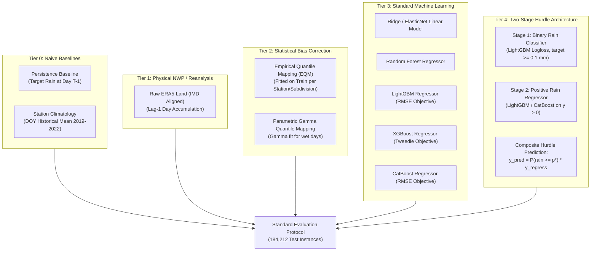

# STAGE 4 EXPERIMENTAL PROTOCOL: BENCHMARKING, MODEL DEVELOPMENT, AND RIGOROUS EVALUATION

**Project:** Machine-Learning-Guided Daily Rainfall Estimation and Forecasting for Karnataka Using High-Resolution ERA5-Land Reanalysis and IMD Observations  
**Document Code:** PROTOCOL-STAGE4-VER-1.0  
**Date:** November 2026  
**Status:** FROZEN & READY FOR IMPLEMENTATION  
**Lead Authors:** Senior Hydrometeorological Research Scientist, ML Engineer, and Data Systems Architect  

---

## 1. Executive Summary & Scientific Purpose

The core research mandate of this project is to answer a fundamental scientific question:
> *Does machine learning (gradient boosted decision trees and two-stage hurdle frameworks) provide genuine, statistically significant hydrometeorological skill over persistence, spatial climatology, raw numerical reanalysis (ERA5-Land), and standard statistical quantile mapping for next-day daily precipitation estimation across the complex orographic and dry interior regimes of Karnataka?*

To prevent the widespread pitfalls in ML-meteorology literature—specifically test set snooping, spatial data leakage, improper threshold definitions, and inconsistent evaluation masks—this document establishes a strictly frozen experimental protocol for Stage 4.

---

## 2. Frozen Dataset Partitions & Partition Hygiene

The dataset prepared in Stage 3 (`stage3_dataset.parquet`, 640,836 valid station-day observations across 252 IMD grid cells over 2,543 calendar days) is strictly partitioned along temporal boundaries:

| Partition | Calendar Dates | Span | In-State Stations | Total Record Count | Purpose & Usage Boundary |
| :--- | :--- | :--- | :--- | :--- | :--- |
| **Training Set** | 2019-01-15 to 2022-12-31 | 1,447 days | 252 | **364,644** | Parameter optimization, tree structure learning, preprocessor fitting (scalers, encoders, imputation). **Initial 14 days (2019-01-01 to 2019-01-14 = 3,528 samples) excluded** as lag warm-up buffer. |
| **Validation Set** | 2023-01-01 to 2023-12-31 | 365 days | 252 | **91,980** | Hyperparameter tuning, early stopping (patience = 50 iterations), hurdle classification decision threshold calibration ($p^*$), feature ablation validation. |
| **Test Set** | 2024-01-01 to 2025-12-31 | 731 days | 252 | **184,212** | **Completely frozen.** Pure out-of-sample forward evaluation. Evaluated exactly once per benchmarked model. Zero parameter adjustments permitted post-evaluation. |
| **Full Dataset** | 2019-01-15 to 2025-12-31 | 2,543 days | 252 | **640,836** | **Zero missing values** across all retained features and targets. |

### Non-Negotiable Partition Hygiene Rules:
1. **Zero Pre-Scaling Leakage:** All scalers (StandardScaler, RobustScaler, PowerTransformer) and frequency/target encodings must be fitted exclusively on the Training set. Applying `.fit_transform()` on concatenated data is strictly prohibited.
2. **Temporal Quarantine:** No time-lagged or rolling statistics computed at inference time may query records beyond $T_{-1}$ (03:00 UTC of Day $T-1$).
3. **Identical Test Sample Mask:** Every baseline and ML model must be scored on exactly the same **184,212 test instances**. Discarding dry days, dropping coastal stations, or evaluating subsets without reporting whole-mask metrics is considered a protocol violation.

---

## 3. Predictor Feature Space Reconciliation

Following the Stage 3.1 schema audit, the 75 columns in `stage3_dataset.parquet` are partitioned into the following functional subsets:

### 3.1. Modeling Predictor Space (63 Eligible Features)
All models will train on the 63 verified causal features:
1. **Rainfall History (IMD Ground Truth Lags & Rolling):**
   - Lags: `target_rain_lag_1d`, `target_rain_lag_2d`, `target_rain_lag_3d`, `target_rain_lag_7d` (4)
   - Rolling Sums: `target_rain_roll_3d_sum`, `target_rain_roll_7d_sum`, `target_rain_roll_14d_sum` (3)
   - Rolling Means: `target_rain_roll_3d_mean`, `target_rain_roll_7d_mean`, `target_rain_roll_14d_mean` (3)
   - Rolling Max: `target_rain_roll_3d_max`, `target_rain_roll_7d_max`, `target_rain_roll_14d_max` (3)
   - Rolling Std: `target_rain_roll_7d_std`, `target_rain_roll_14d_std` (2)
   - Dry Spell Count: `consecutive_dry_days` (1)
2. **ERA5-Land Total Precipitation Lags:**
   - Lags: `era5_tp_lag_1d`, `era5_tp_lag_2d`, `era5_tp_lag_3d`, `era5_tp_lag_7d` (4)
   - Rolling Sums: `era5_tp_roll_3d_sum`, `era5_tp_roll_7d_sum`, `era5_tp_roll_14d_sum` (3)
   - Rolling Max: `era5_tp_roll_3d_max`, `era5_tp_roll_7d_max` (2)
3. **Thermodynamic & Kinematic Fluxes (Lag 1D):**
   - Thermal: `t2m_mean_lag_1d`, `t2m_max_lag_1d`, `t2m_min_lag_1d`, `d2m_mean_lag_1d`, `diurnal_temperature_range_lag_1d` (5)
   - Moisture & Pressure: `dewpoint_depression_lag_1d`, `relative_humidity_lag_1d`, `vapor_pressure_deficit_kpa_lag_1d`, `sp_mean_lag_1d` (4)
   - Energy Radiation: `ssrd_daily_j_m2_lag_1d`, `strd_daily_j_m2_lag_1d`, `ssr_daily_j_m2_lag_1d`, `str_daily_j_m2_lag_1d` (4)
   - Turbulent Heat Fluxes: `slhf_daily_j_m2_lag_1d`, `sshf_daily_j_m2_lag_1d` (2)
   - Hydrological Evaporation & Runoff: `e_daily_m_lag_1d`, `pev_daily_m_lag_1d`, `ro_daily_m_lag_1d`, `sro_daily_m_lag_1d` (4)
   - Soil Moisture & Temperature: `swvl1_lag_1d`, `swvl2_lag_1d`, `swvl3_lag_1d`, `swvl4_lag_1d`, `stl1_mean_lag_1d` (5)
   - Dynamic Wind Field: `u10_mean_lag_1d`, `v10_mean_lag_1d`, `wind_speed_10m_mean_lag_1d`, `wind_speed_10m_max_lag_1d` (4)
4. **Static Geophysical & Topographic:**
   - `latitude`, `longitude`, `elevation_m` (SRTM validated), `slope_deg` (SRTM validated), `subdivision` (categorical/target encoded), `zone_id` (6)
5. **Temporal & Astrodynamic Features:**
   - `day_of_year`, `doy_sin`, `doy_cos`, `month` (4)

### 3.2. Administrative and Non-Predictor Columns (Excluded from $X$)
- Identifiers: `date`, `station_id`, `district`, `zone_name` (4)
- Verification Metadata: `prediction_issue_time`, `target_period` (2)
- Data Quality Flags: `is_coastal_fallback`, `interpolation_method` (2)
- Redundant String: `season` (1; captured by `month` and `doy`)
- Ground Truth Targets: `target_rainfall_mm`, `target_is_rain`, `target_is_heavy_rain` (3)

---

## 4. Benchmark Hierarchy

To rigorously evaluate ML performance, models must compete against standard hydrometeorological baselines:

### Detailed Baseline Formulations:
1. **Persistence Baseline ($B_{\text{pers}}$):**
   $$\hat{y}_{s, t} = y_{s, t-1}$$
   The observed IMD rainfall of station $s$ on the previous day.
2. **Station Day-of-Year Climatology ($B_{\text{clim}}$):**
   $$\hat{y}_{s, t} = \frac{1}{|K_{\text{train}}|} \sum_{k \in K_{\text{train}}} y_{s, \text{doy}(t), k}$$
   The multi-year mean observed rainfall for station $s$ on the specific day of the year across the training set (2019–2022), smoothed by a 7-day Gaussian kernel window.
3. **Raw ERA5-Land Reanalysis ($B_{\text{era5}}$):**
   $$\hat{y}_{s, t} = \text{ERA5\_tp}_{s, t-1}$$
   The corrected IMD-aligned daily total precipitation from ERA5-Land at station $s$ ending at 03:00 UTC of Day $T-1$.
4. **Empirical Quantile Mapping ($B_{\text{eqm}}$):**
   $$\hat{y}_{s, t} = F_{\text{obs}, s}^{-1} \left( F_{\text{era5}, s}(\text{ERA5\_tp}_{s, t-1}) \right)$$
   Where $F_{\text{obs}}$ and $F_{\text{era5}}$ are empirical cumulative distribution functions calibrated per station over the 2019–2022 training partition.

---

## 5. Machine Learning Architectures & Loss Functions

Rainfall distributions are zero-inflated (65% zeros across Karnataka) and heavy-tailed. Standard Mean Squared Error (MSE) minimization forces models towards conditional means, causing severe underestimation of peak monsoonal precipitation. The protocol therefore evaluates three distinct modeling paradigms:

### 5.1. Tweedie Compound Poisson-Gamma Regression
For direct end-to-end regression, LightGBM and XGBoost will optimize the Tweedie deviance with variance power $p \in (1.1, 1.9)$:
$$\mathcal{L}_{\text{Tweedie}}(y, \mu) = - \left( \frac{y \mu^{1-p}}{1-p} - \frac{\mu^{2-p}}{2-p} \right)$$
This handles the zero point-mass while modeling the continuous positive distribution.

### 5.2. Asymmetric Extreme-Value / Quantile Loss
Models will also be trained with Pinball Loss to estimate upper quantiles ($\tau = 0.50, 0.75, 0.90, 0.95$):
$$\mathcal{L}_{\tau}(y, \hat{y}) = \max(\tau(y - \hat{y}), (1 - \tau)(\hat{y} - y))$$

### 5.3. Two-Stage Hurdle Model Architecture (Primary Architecture)
The recommended architecture decouples rain occurrence from rain intensity:
1. **Classifier $\mathcal{M}_C$:** LightGBM Binary Classifier trained on `target_is_rain` ($y \ge 0.1\text{ mm}$) optimizing Log-loss. Output is probability $\hat{p}_{s, t} = P(y_{s, t} \ge 0.1)$.
   - Threshold calibration: Find optimal threshold $p^* \in [0.2, 0.6]$ on the 2023 Validation Set to maximize Heidke Skill Score (HSS) and Critical Success Index (CSI).
2. **Regressor $\mathcal{M}_R$:** LightGBM / CatBoost Regressor trained exclusively on wet observations ($y \ge 0.1\text{ mm}$) with target $\ln(y + 1)$ or Box-Cox transformation.
3. **Synthesis:**
   $$\hat{y}_{s, t} = \begin{cases} 0.0 & \text{if } \hat{p}_{s, t} < p^* \\ \exp(\hat{y}_{\text{reg}, s, t}) - 1 & \text{if } \hat{p}_{s, t} \ge p^* \end{cases}$$

---

## 6. Comprehensive Evaluation Metric Suite

Performance will be quantified simultaneously across three operational dimensions:

### 6.1. Continuous Hydrological Accuracy
1. **Root Mean Squared Error (RMSE):**
   $$\text{RMSE} = \sqrt{\frac{1}{N} \sum_{i=1}^N (y_i - \hat{y}_i)^2}$$
2. **Mean Absolute Error (MAE):**
   $$\text{MAE} = \frac{1}{N} \sum_{i=1}^N |y_i - \hat{y}_i|$$
3. **Pearson Correlation Coefficient ($r$):**
   $$r = \frac{\sum (y_i - \bar{y})(\hat{y}_i - \bar{\hat{y}})}{\sqrt{\sum (y_i - \bar{y})^2 \sum (\hat{y}_i - \bar{\hat{y}})^2}}$$
4. **Nash-Sutcliffe Efficiency (NSE):**
   $$\text{NSE} = 1 - \frac{\sum_{i=1}^N (y_i - \hat{y}_i)^2}{\sum_{i=1}^N (y_i - \bar{y})^2}$$
5. **Kling-Gupta Efficiency (KGE-2012):**
   $$\text{KGE} = 1 - \sqrt{(r - 1)^2 + (\beta - 1)^2 + (\gamma - 1)^2}$$
   Where $\beta = \frac{\bar{\hat{y}}}{\bar{y}}$ (bias ratio), and $\gamma = \frac{\text{CV}_{\hat{y}}}{\text{CV}_y} = \frac{\sigma_{\hat{y}} / \bar{\hat{y}}}{\sigma_y / \bar{y}}$ (variability ratio).
6. **Percent Bias (PBias):**
   $$\text{PBias} = 100 \times \frac{\sum (y_i - \hat{y}_i)}{\sum y_i}$$

### 6.2. Categorical & Extreme Event Contingency Metrics
Evaluated at official IMD thresholds ($T_0 = 0.1\text{ mm}$, $T_1 = 15.6\text{ mm}$, $T_2 = 64.5\text{ mm}$):

| Contingency Table | Observed Yes ($y \ge T$) | Observed No ($y < T$) |
| :--- | :--- | :--- |
| **Forecast Yes** ($\hat{y} \ge T$) | Hits ($H$) | False Alarms ($F$) |
| **Forecast No** ($\hat{y} < T$) | Misses ($M$) | Correct Negatives ($C$) |

1. **Probability of Detection (POD / Recall):**
   $$\text{POD} = \frac{H}{H + M}$$
2. **False Alarm Ratio (FAR):**
   $$\text{FAR} = \frac{F}{H + F}$$
3. **Critical Success Index (CSI / Threat Score):**
   $$\text{CSI} = \frac{H}{H + M + F}$$
4. **Equitable Threat Score (ETS):**
   $$\text{ETS} = \frac{H - H_{\text{exp}}}{H + M + F - H_{\text{exp}}}, \quad H_{\text{exp}} = \frac{(H+M)(H+F)}{N}$$
5. **Heidke Skill Score (HSS):**
   $$\text{HSS} = \frac{2(HC - MF)}{(H+M)(M+C) + (H+F)(F+C)}$$

### 6.3. Spatial & Subdivisional Breakdown
All continuous and categorical metrics must be computed and reported separately across Karnataka's 4 meteorological subdivisions:
1. **Coastal Karnataka** (High rainfall intensity, steep Western Ghats orographic barrier).
2. **South Interior Karnataka - Malnad** (Transition plateau, heavy catchment precipitation).
3. **South Interior Karnataka - Plain** (Semi-arid to sub-humid agricultural belt).
4. **North Interior Karnataka** (Arid/semi-arid rain-shadow plateau, dominated by convective showers).

---

## 7. Hyperparameter Tuning & Validation Strategy

1. **Algorithm:** Bayesian Optimization using Optuna or Hyperband with 100 trials on the 2023 Validation Set.
2. **Early Stopping:** Monitored against Validation loss (RMSE or multi-metric composite) with a strict patience of 50 rounds.
3. **Primary Loss for Selection:** Composite Validation Score:
   $$\text{Score} = \text{KGE}_{\text{val}} + \text{CSI}_{64.5, \text{val}} - 0.5 \times \text{MAE}_{\text{val}}$$
4. **Candidate Algorithms:**
   - Linear/Ridge baseline (`scikit-learn`)
   - Random Forest Regressor (`scikit-learn`)
   - LightGBM Regressor & Classifier (`lightgbm`)
   - XGBoost Regressor (`xgboost`)
   - CatBoost Regressor & Classifier (`catboost`)
   - Two-Stage Hurdle Architecture (`Hurdle-LGBM`, `Hurdle-CatBoost`)

---

## 8. Artifact Generation & Deliverables Checklist for Stage 4

When executing Stage 4, the following artifacts must be systematically generated and archived in `Stage4_Model_Development/`:
- `models/`: Serialized model binaries (`.joblib` or `.json`), including preprocessors and threshold calibrations.
- `predictions/`: Out-of-sample predictions on the 184,212 test instances for every model in Parquet format.
- `tables/`: Comprehensive benchmark comparison tables (`benchmark_continuous_metrics.csv`, `benchmark_categorical_metrics.csv`, `subdivision_performance_breakdown.csv`).
- `figures/`: High-resolution figures:
  * Parity scatter plots ($\hat{y}$ vs $y$) with density contours.
  * Spatial KGE, RMSE, and CSI maps across the 252 station grid.
  * Categorical performance diagrams (Roebber Performance Diagrams).
  * Feature importance rankings (SHAP summary plots).
- `stage4_experimental_report.md`: Formal scientific synthesis report presenting all findings and comparative hypotheses testing.

---

## 9. Stage Gate Certification

**Protocol Status:** APPROVED & FROZEN  
**Sign-off Criteria:**
1. No training or tuning runs may modify partition date boundaries.
2. Zero data leakage across feature transformations.
3. Test partition evaluated only once upon completion of tuning.
4. Evaluation executed across all 184,212 test samples under identical spatial masks.

