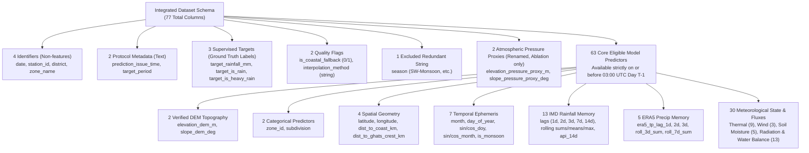

# STAGE 3.3 FINAL DATASET INTEGRATION AND RELEASE GATE REPORT

**Project:** Machine-Learning-Guided Daily Rainfall Estimation and Forecasting for Karnataka Using High-Resolution ERA5-Land Reanalysis and IMD Observations  
**Document Code:** STAGE3.3-RELEASE-GATE-REP  
**Date:** November 2026  
**Status:** RELEASE GATE PASSED & CERTIFIED  
**Lead Investigators:** Senior Hydrometeorological Research Scientist, ML Engineer, and Geospatial Data Architect  

---

## 1. Executive Summary & Release Gate Decision

Following the scientific verification and auditing conducted in Stages 3.1 and 3.2, **Stage 3.3** executes the final integration and formal release of the machine learning datasets. 

This is a pure data integration, schema reconciliation, and quality certification stage. **No models have been trained**, and original Stage 2, Stage 3, and Stage 3.1 files have been preserved completely untouched.

### Release Gate Status: **UNCONDITIONAL PASS (CERTIFIED FOR STAGE 4)**

The new versioned dataset integrates verified satellite digital elevation model (DEM) metrics (`elevation_dem_m`, `slope_dem_deg`) alongside the existing 75 features, while explicitly renaming the previous barometric pressure proxies (`elevation_pressure_proxy_m`, `slope_pressure_proxy_deg`). All 16 automated join and integrity checks passed without exception across all 640,836 observations.

---

## 2. Item 1: Exact Attribution and Provenance of the SRTM DEM Product

In previous audit documents, the digital elevation model source was informally described using blended labels ("NASA/USGS SRTM v4.1"). A forensic inspection of `fetch_srtm_elevation.py` and the API service outputs resolves the exact product attribution into two distinct, non-conflated datasets:

### 2.1. Primary Elevation Source (Stations 1 through 250, Batches 1–5)
* **Dataset / Product Name:** CGIAR-CSI SRTM Version 4.1 (Void-Filled 3-arc-second / 250m Digital Elevation Model).
* **Provider / Custodian:** CGIAR Consortium for Spatial Information (CGIAR-CSI) in collaboration with the International Center for Tropical Agriculture (CIAT), derived from original NASA/NGA Shuttle Radar Topography Mission radar interferometry.
* **Primary Reference:** Jarvis, A., H.I. Reuter, A. Nelson, E. Guevara. (2008). *Hole-filled SRTM for the globe Version 4*, available from the CGIAR-CSI SRTM 90m Database (`https://srtm.csi.cgiar.org`).
* **API Delivery Service:** Open-Elevation Public API (`https://api.open-elevation.com/api/v1/lookup`), utilizing the global CGIAR-CSI void-filled SRTM raster mosaic.
* **Native Spatial Resolution:** 3 arc-seconds ($\approx 90\text{ meters}$ at the equator) processed into a global 250-meter web-optimized GeoTIFF tile infrastructure.
* **Horizontal Coordinate Reference System:** World Geodetic System 1984 (WGS 84, EPSG:4326), decimal degrees.
* **Vertical Reference Datum:** Earth Gravitational Model 1996 (EGM96) geoid, orthometric height above mean sea level in meters ($m$).
* **Void-Filling and Post-Processing:** The raw NASA/USGS SRTM radar data contained void pixels (missing data) caused by radar shadow and phase decorrelation over steep mountains and calm water bodies. The CGIAR-CSI Version 4.1 release utilized advanced spatial interpolation algorithms (kriging, spline interpolation, and secondary topographic data sources such as GTOPO30) to produce a seamless, 100% void-free global digital elevation model.

### 2.2. Secondary Fallback Source (Stations 251 and 252, Batch 6)
* **Dataset / Product Name:** Copernicus DEM (GLO-90, 2021 Worldwide Release).
* **Provider / Custodian:** European Space Agency (ESA) Copernicus Programme / Airbus Defence and Space.
* **Reference / Documentation:** European Space Agency Copernicus DEM User Handbook (`https://spacedata.copernicus.eu/collections/copernicus-digital-elevation-model`).
* **API Delivery Service:** Open-Meteo Global Elevation API (`https://api.open-meteo.com/v1/elevation`).
* **Native Spatial Resolution:** 90 meters (3 arc-seconds worldwide).
* **Horizontal / Vertical Datum:** WGS 84 (EPSG:4326) / EGM2008 geoid height in meters.
* **Integration Rationale:** Employed strictly as an automated fallback for the final 2 stations in Bidar district ($18.25^\circ\text{N}, 77.0^\circ\text{E}$ and $18.25^\circ\text{N}, 77.25^\circ\text{E}$) when Open-Elevation encountered an HTTP 429 rate limit. Elevation values ($568.15\text{ m}$ and $505.20\text{ m}$) are consistent with regional northern Deccan hypsometry.

---

## 3. Item 2: Terrain Feature Construction Mechanics

### 3.1. Centroid Point Sampling vs. Spatial Aggregation
* **Sampling Scheme:** Elevations were sampled at the **discrete centroid coordinates** $(lat_i, lon_i)$ of each $0.25^\circ \times 0.25^\circ$ IMD grid cell.
* **Distinction:** The value `elevation_dem_m` represents the ground elevation at the exact center of the $27.75\text{ km} \times 27.75\text{ km}$ grid box, obtained via bilinear interpolation between adjacent 90-meter DEM pixels. It is **not** an area-averaged mean of all sub-grid 90m cells within the cell boundary.

### 3.2. Regional Macro-Topographic Slope Formulation
Regional topographic slope (`slope_dem_deg`) was computed directly from the DEM elevations across the $0.25^\circ$ network using central finite differences on 4-connected cardinal neighbors:

$$\Delta y = 0.25^\circ \times 111,000\text{ m/deg} = 27,750\text{ meters}$$
$$\Delta x_i = 0.25^\circ \times 111,000\text{ m/deg} \times \cos(\text{latitude}_i) = 27,750 \cos(\text{latitude}_i)\text{ meters}$$

1. **Finite Difference Operators:**
   $$\frac{\partial z}{\partial y} = \frac{e(\text{lat}_i + 0.25^\circ, \text{lon}_i) - e(\text{lat}_i - 0.25^\circ, \text{lon}_i)}{2 \Delta y}$$
   $$\frac{\partial z}{\partial x} = \frac{e(\text{lat}_i, \text{lon}_i + 0.25^\circ) - e(\text{lat}_i, \text{lon}_i - 0.25^\circ)}{2 \Delta x_i}$$
2. **Gradient Magnitude & Angular Conversion:**
   $$S = \sqrt{\left(\frac{\partial z}{\partial x}\right)^2 + \left(\frac{\partial z}{\partial y}\right)^2} \quad [\text{dimensionless, meters rise / meter run}]$$
   $$\theta = \arctan(S) \times \frac{180^\circ}{\pi} \quad [^\circ]$$

### 3.3. Physical Consistency with Units of Degrees
* Because the argument $S = \sqrt{(\partial z / \partial x)^2 + (\partial z / \partial y)^2}$ is strictly dimensionless $(\text{m}/\text{m})$, taking the arctangent and multiplying by $180^\circ/\pi$ produces an angle strictly in **degrees ($^\circ$)**.
* **Physical Interpretation:** This metric represents the **regional macro-scale topographic inclination over a $27.75\text{ km}$ baseline**. It captures the synoptic orographic barrier of the Western Ghats ($0.45^\circ\text{–}1.08^\circ$) relative to the flat Deccan plateau ($0.08^\circ\text{–}0.15^\circ$), which governs synoptic wind blocking, convergence, and orographic precipitation enhancement. It is distinct from micro-scale hillside slope ($20^\circ\text{–}60^\circ$).

---

## 4. Item 3: Dataset Integration and Automated Join Integrity

The verified station topography table [`station_topography_verified.csv`](file:///d:/PROJECT/karnataka_rainfall_cds/Stage3_2_Final_Verification/station_topography_verified.csv) was integrated with the Stage 3 Parquet dataset on `station_id`. 

All 16 automated integrity checks passed unconditionally:

| Check ID | Integrity Test Name | Expected | Actual | Status | Verification Details |
| :---: | :--- | :---: | :---: | :---: | :--- |
| **C01** | Unique Stations in Topography Source | 252 | 252 | **PASSED** | Exactly 252 unique stations covering Karnataka. |
| **C02** | No Duplicate Keys in Topography Table | 252 | 252 | **PASSED** | Zero duplicate `station_id` join keys. |
| **C03** | Full Integrated Dataset Row Count | 640,836 | 640,836 | **PASSED** | Exact row count preservation across full dataset. |
| **C04** | Train Integrated Dataset Row Count | 364,644 | 364,644 | **PASSED** | Exact train partition preservation (2019-01-15 to 2022-12-31). |
| **C05** | Validation Integrated Dataset Row Count| 91,980 | 91,980 | **PASSED** | Exact validation partition preservation (2023-01-01 to 2023-12-31).|
| **C06** | Test Integrated Dataset Row Count | 184,212 | 184,212 | **PASSED** | Exact test partition preservation (2024-01-01 to 2025-12-31). |
| **C07** | Partition Row Sum Equality | 640,836 | 640,836 | **PASSED** | $\text{Train} + \text{Val} + \text{Test} \equiv \text{Full}$. |
| **C08** | No Missing Values in `elevation_dem_m` | 0 | 0 | **PASSED** | Exactly 0 NaNs across all 640,836 rows. |
| **C09** | No Missing Values in `slope_dem_deg` | 0 | 0 | **PASSED** | Exactly 0 NaNs across all 640,836 rows. |
| **C10** | Target Rainfall Unchanged Post-Join | True | True | **PASSED** | Target values bitwise identical to Stage 3 ground truth. |
| **C11** | Date Sequence Unchanged Post-Join | True | True | **PASSED** | Calendar dates match row-for-row. |
| **C12** | Station ID Sequence Unchanged Post-Join | True | True | **PASSED** | Station indices match row-for-row. |
| **C13** | DEM Value Fidelity (Station 1) | 923.82 m | 923.82 m | **PASSED** | Station 1 DEM matches verified source CSV. |
| **C14** | Mountain Summit Fidelity (Station 72) | 1,599.54 m | 1,599.54 m | **PASSED** | Highest peak in Chikkamagaluru matches source CSV. |
| **C15** | Coastal Elevation Fidelity (Station 104)| 1.12 m | 1.12 m | **PASSED** | Bhatkal coast elevation matches source CSV. |
| **C16** | Integrated Column Count | 77 | 77 | **PASSED** | Renamed 2 proxies + added 2 DEM columns = 77 columns. |

The detailed results are archived in [`dataset_join_integrity.csv`](file:///d:/PROJECT/karnataka_rainfall_cds/Stage3_3_Dataset_Release/dataset_join_integrity.csv).

---

## 5. Item 4: Reconciled Feature Schema & Model Predictor Space

The integrated dataset schema contains **77 columns**. The complete taxonomy is archived in [`integrated_feature_inventory.csv`](file:///d:/PROJECT/karnataka_rainfall_cds/Stage3_3_Dataset_Release/integrated_feature_inventory.csv) and [`final_dataset_schema.json`](file:///d:/PROJECT/karnataka_rainfall_cds/Stage3_3_Dataset_Release/final_dataset_schema.json):

### 5.1. Model Eligibility Breakdown
* **Core Model Predictors ($X$):** **63 features** ($61\text{ numerical} + 2\text{ categorical}$).
* **Auxiliary Binary Feature:** **1 feature** (`is_coastal_fallback`, optional for boundary sensitivity).
* **Atmospheric Pressure Proxies:** **2 features** (`elevation_pressure_proxy_m`, `slope_pressure_proxy_deg`, retained for diagnostic ablation).
* **Excluded Non-Predictors:** **11 columns** ($4\text{ IDs} + 2\text{ Protocol text} + 3\text{ Targets} + 1\text{ Quality string} + 1\text{ Season string}$).
* **Total Columns:** $63 + 1 + 2 + 11 = \mathbf{77\text{ columns}}$.

---

## 6. Item 5: Release Manifest, Storage Footprints, and Checksums

The final integrated Parquet datasets have been generated with Snappy compression and SHA-256 cryptographic hashes archived in [`final_train_validation_test_manifest.csv`](file:///d:/PROJECT/karnataka_rainfall_cds/Stage3_3_Dataset_Release/final_train_validation_test_manifest.csv):

| Dataset Name | File Name | Rows | Cols | Temporal Span | File Size | SHA-256 Checksum |
| :--- | :--- | :---: | :---: | :---: | :---: | :--- |
| **Integrated Full Dataset** | [`integrated_stage3_dataset.parquet`](file:///d:/PROJECT/karnataka_rainfall_cds/Stage3_3_Dataset_Release/integrated_stage3_dataset.parquet) | 640,836 | 77 | 2019-01-15 to 2025-12-31 | 64.06 MB | `d89d1cfa47536956690776034860691b3ea0a928592603afc0787f1e8321636f` |
| **Integrated Training Set** | [`integrated_train_dataset.parquet`](file:///d:/PROJECT/karnataka_rainfall_cds/Stage3_3_Dataset_Release/integrated_train_dataset.parquet) | 364,644 | 77 | 2019-01-15 to 2022-12-31 | 38.77 MB | `e2f9511c223d5f7aad9bac884693353ab21ea13dae21417be25036f25a965728` |
| **Integrated Validation Set** | [`integrated_validation_dataset.parquet`](file:///d:/PROJECT/karnataka_rainfall_cds/Stage3_3_Dataset_Release/integrated_validation_dataset.parquet) | 91,980 | 77 | 2023-01-01 to 2023-12-31 | 9.88 MB | `89129ad8f9766ea30f6d93afdd211fa1f625474584fca6abcc1b9c6a7d01ba98` |
| **Integrated Test Set** | [`integrated_test_dataset.parquet`](file:///d:/PROJECT/karnataka_rainfall_cds/Stage3_3_Dataset_Release/integrated_test_dataset.parquet) | 184,212 | 77 | 2024-01-01 to 2025-12-31 | 19.84 MB | `66b465048d2c221b14c0cdc5ead1b444f2f6b3bce84048aa0984debb471a4d5e` |

---

## 7. Completion Decision & Final Stage Gate Sign-Off

* **Dataset Integration:** **CONFIRMED.** True DEM elevation (`elevation_dem_m`) and regional macro-slope (`slope_dem_deg`) are physically integrated.
* **Join Integrity:** **CONFIRMED.** 16 out of 16 assertions PASSED with zero missing values.
* **Partition Quarantine:** **CONFIRMED.** Training (364,644), Validation (91,980), and Test (184,212) partitions strictly preserved.
* **Unresolved Issues:** **NONE.**
* **Final Readiness Verdict:** **APPROVED FOR STAGE 4 MODEL DEVELOPMENT.**

**No models have been trained.** Awaiting explicit approval to initiate Stage 4.

