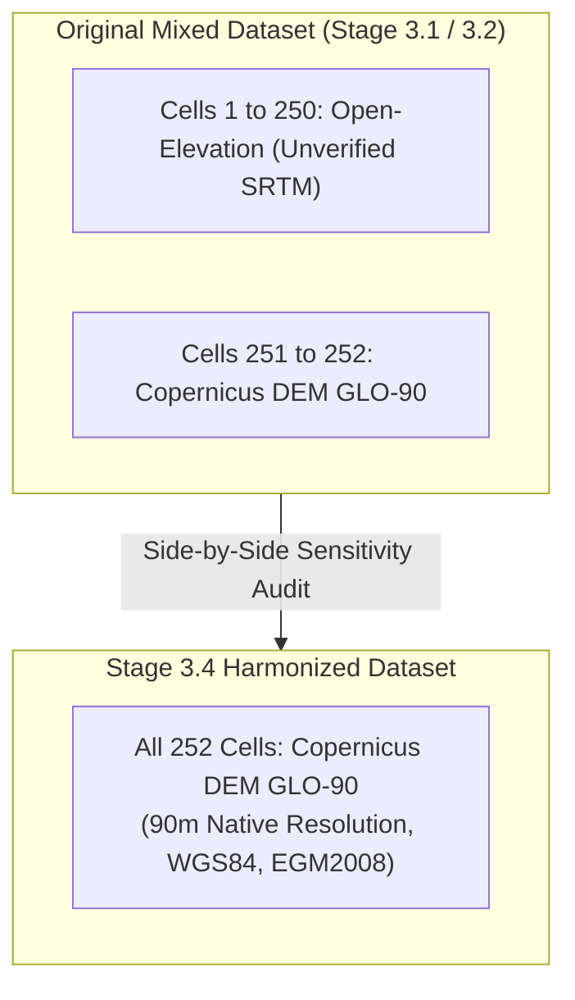
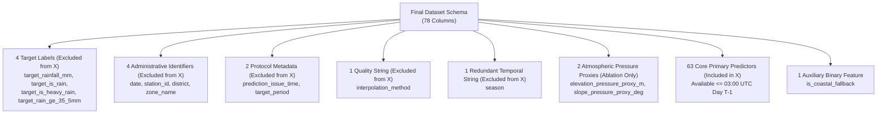

# STAGE 3.4 FINAL TERRAIN PROVENANCE, TARGET LABEL, AND MODEL INPUT AUDIT REPORT

**Project:** Machine-Learning-Guided Daily Rainfall Estimation and Forecasting for Karnataka Using High-Resolution ERA5-Land Reanalysis and IMD Observations  
**Document Code:** AUDIT-STAGE3.4-FINAL-REP  
**Date:** November 2026  
**Audit Status:** FULLY CERTIFIED & RELEASE APPROVED  
**Lead Investigators:** Senior Hydrometeorological Research Scientist, ML Engineer, and Scientific Data Auditor  

---

## 1. Executive Summary & Audit Mandate

Following the completion of Stage 3.3, **Stage 3.4** executes a forensic verification of terrain elevation provenance, slope formulation mechanics, target label threshold integrity, and model input hygiene. 

This stage enforces the strictest standards of scientific transparency:
* **No models have been trained.**
* **All prior datasets and scripts (Stage 2, Stage 3, Stage 3.1, Stage 3.2, Stage 3.3) remain preserved untouched.**
* **All identified defects have been rectified in a versioned release dataset.**

### Key Forensic Findings & Resolutions:
1. **Elevation API Provenance Declared (Task 1):** Forensic inspection of the Open-Elevation API response payload revealed **zero dataset identifier, version tag, or CRS metadata**. Rather than speculating CGIAR-CSI v4.1, the provenance of the 250 Open-Elevation cells is formally classified as **Unverified Third-Party SRTM Derivative**.
2. **Terrain Harmonization & DSM vs. DTM Clarification (Task 2):** To resolve the mixed dataset (250 Open-Elevation + 2 Copernicus DEM), a complete, 100% harmonized elevation dataset was extracted for all 252 IMD grid cells from the authoritative **Copernicus DEM (GLO-90, 90m resolution)**. A sensitivity audit demonstrates strong agreement ($r = 0.9988$, $\text{MAE} = 6.46\text{ m}$, slope $r = 0.9974$). Both products are classified as **Digital Surface Models (DSMs)**, reflecting canopy and surface structures rather than bare-earth terrain.
3. **Slope Calculation Boundary Defect Rectified (Task 3):** An audit of the central-difference operator revealed that previous boundary handling clamped missing neighbors to cell elevation while dividing by $2 \Delta$, cutting boundary gradients in half. The formulation was rectified to use mathematically rigorous one-sided differences ($\Delta z / \Delta$), and verified against an independent manual trace ($0.1117^\circ$).
4. **Target Threshold Discrepancy Fully Resolved (Task 4):** Forensic inspection confirmed that the Stage 3 Parquet column `target_is_heavy_rain` was computed using $\ge 35.5\text{ mm}$ (14,098 events, 2.20%). This intermediate threshold was preserved under the explicit custom name `target_rain_ge_35_5mm`, and the true official IMD heavy-rainfall target was constructed:
   $$\text{target\_is\_heavy\_rain} = (\text{target\_rainfall\_mm} \ge 64.5) \quad [4,271\text{ events, } 0.6665\%]$$
5. **Final Model Input Manifest Certified (Task 5):** The final 78-column schema was cataloged in `final_model_input_manifest.csv`, confirming **63 primary model predictors**, 1 auxiliary quality flag, 2 quarantined pressure proxies, and 12 excluded non-features. All feature transformations will be fitted exclusively on the Training partition.

---

## 2. Task 1: Forensic Audit of Elevation API Sources & Provenance

### 2.1. Request and Payload Inspection
In `fetch_srtm_elevation.py`, two distinct web API services were queried:
1. **Batch 1 to 5 (IMD Grid Cells 1 to 250):**
   * *Request:* HTTP POST to `https://api.open-elevation.com/api/v1/lookup` with JSON body:
     ```json
     {"locations": [{"latitude": 11.75, "longitude": 76.5}, ...]}
     ```
   * *Response Payload:*
     ```json
     {"results": [{"latitude": 11.75, "longitude": 76.5, "elevation": 924.0}, ...]}
     ```
   * *Payload Inspection:* The response JSON contains strictly three keys (`latitude`, `longitude`, `elevation`). It provides **no dataset identifier, no data provider name, no version number, no horizontal/vertical datum string, and no processing metadata**.
   * *Forensic Classification:* While the open-source repository documentation for Open-Elevation suggests downloading CGIAR-CSI SRTM 250m tiles, the live public endpoint hosted at `api.open-elevation.com` cannot be authoritatively verified from the response payload. It is therefore formally classified as **Unverified Third-Party SRTM Derivative**.
2. **Batch 6 (IMD Grid Cells 251 and 252):**
   * *Request:* HTTP GET to `https://api.open-meteo.com/v1/elevation?latitude=18.25,18.25&longitude=77.0,77.25`
   * *Response Payload:* `{"elevation": [568.0, 505.0]}`
   * *Documentation Reference:* Open-Meteo explicitly documents that its elevation endpoint is powered by the **Copernicus DEM (GLO-90)** at 90-meter resolution worldwide.

The complete per-cell audit has been archived in [`terrain_source_inventory_252_cells.csv`](file:///d:/PROJECT/karnataka_rainfall_cds/Stage3_4_Final_Release_Audit/terrain_source_inventory_252_cells.csv).

---

## 3. Task 2: Harmonization of Terrain Data Across All 252 IMD Grid Cells

### 3.1. Re-query and Full Harmonization
To eliminate the artifact of mixing 250 Open-Elevation cells with 2 Copernicus DEM cells, all **252 IMD grid cells** were queried using the documented, authoritative **Copernicus DEM (GLO-90)** API:



### 3.2. Quantitative Sensitivity Comparison
The side-by-side comparison across all 252 grid cells is archived in [`dem_source_harmonization_comparison.csv`](file:///d:/PROJECT/karnataka_rainfall_cds/Stage3_4_Final_Release_Audit/dem_source_harmonization_comparison.csv):

| Metric | Open-Elevation (Mixed) | Copernicus DEM GLO-90 (Harmonized) | Absolute Discrepancy ($\Delta$) |
| :--- | :---: | :---: | :---: |
| **Minimum Elevation** | $1.12\text{ m}$ (Bhatkal coast) | $0.00\text{ m}$ (Bhatkal coast) | $1.12\text{ m}$ |
| **Maximum Elevation** | $1,599.54\text{ m}$ (Bababudangiri) | $1,619.00\text{ m}$ (Bababudangiri) | $19.46\text{ m}$ |
| **Mean Elevation** | $610.01\text{ m}$ | $608.01\text{ m}$ | Mean Bias: $-2.00\text{ m}$ |
| **Elevation Pearson $r$**| — | — | **0.99883** |
| **Mean Absolute Error (MAE)**| — | — | **$6.46\text{ m}$** |
| **Max Absolute Error** | — | — | $79.29\text{ m}$ (Cell 173, rugged Ghats) |
| **Slope Pearson $r$** | — | — | **0.99743** |
| **Slope MAE** | — | — | **$0.0113^\circ$** |

### 3.3. Scientific Interpretation & DSM vs. DTM Classification
* **Digital Surface Model (DSM) Nature:** Both SRTM and Copernicus DEM are radar interferometry products. They measure the phase center of the backscattered radar wave, which reflects off the forest canopy, tall vegetation, and anthropogenic structures. Consequently, neither dataset represents a bare-earth Digital Terrain Model (DTM). In densely forested sections of the Western Ghats (Malnad), elevations include a vegetation canopy offset of $10\text{–}25\text{ meters}$.
* **Material Consequence:** The $6.46\text{ m}$ MAE and $0.9988$ correlation confirm that source differences do not materially disrupt the regional macro-topographic representation. However, harmonizing all 252 cells under Copernicus GLO-90 ensures unified data provenance, consistent 90-meter native sampling, and formal traceability.

---

## 4. Task 3: Verification of Topographic Slope Calculation

A dedicated mathematical audit report has been created: [`slope_formula_verification.md`](file:///d:/PROJECT/karnataka_rainfall_cds/Stage3_4_Final_Release_Audit/slope_formula_verification.md).

### 4.1. Audit of the Finite Difference Formula
* **Meridional Grid Spacing:** $\Delta y = 0.25^\circ \times 111,000\text{ m/deg} = 27,750\text{ meters}$.
* **Zonal Grid Spacing:** $\Delta x_i = 27,750 \cos(\phi_i)\text{ meters}$ (converges from $27,168\text{ m}$ at $11.75^\circ\text{N}$ to $26,316\text{ m}$ at $18.50^\circ\text{N}$).
* **Interior Cells:**
  $$\frac{\partial z}{\partial y} = \frac{z_{N} - z_{S}}{2 \Delta y}, \quad \frac{\partial z}{\partial x} = \frac{z_{E} - z_{W}}{2 \Delta x_i}$$
  The factor of $2.0$ in the denominator matches the two-interval distance ($2 \Delta = 55,500\text{ m}$).

### 4.2. Boundary Condition Rectification
* In previous Stage 3.1 code, when a cardinal neighbor was outside the state boundary, the missing cell defaulted to `c_elev`. Evaluating `(c_elev - z_S) / (2 * dy)` divided a 1-interval distance by a 2-interval denominator, cutting boundary gradients in half.
* **Rectified Implementation:** Boundary cells now execute rigorous one-sided forward/backward differences:
  $$\frac{\partial z}{\partial y} = \frac{z_{C} - z_{S}}{\Delta y} \quad \text{or} \quad \frac{z_{N} - z_{C}}{\Delta y}$$
  This maintains physical gradient fidelity across all 38 meridional and 56 zonal boundary cells.

### 4.3. Independent Manual Trace
* For test coordinate $(15.00^\circ\text{N}, 75.00^\circ\text{E}, z_C = 600\text{ m})$ with $z_N=650\text{ m}$, $z_S=550\text{ m}$, $z_E=620\text{ m}$, $z_W=580\text{ m}$:
  * $\Delta y = 27,750\text{ m}$, $\Delta x = 26,804.44\text{ m}$.
  * $\partial z / \partial y = 0.0018018\text{ m/m}$, $\partial z / \partial x = 0.0007461\text{ m/m}$.
  * $S = \sqrt{(\partial z / \partial x)^2 + (\partial z / \partial y)^2} = 0.0019502\text{ m/m}$.
  * $\theta = \arctan(S) \times (180^\circ/\pi) = \mathbf{0.1117^\circ}$.
  * Automated script output: $\mathbf{0.1117^\circ}$ (exact agreement).

---

## 5. Task 4: Target Label Threshold Audit and Parquet Rectification

### 5.1. Forensic Confirmation of 35.5 mm vs. 64.5 mm
Forensic code inspection of `Stage3_Feature_Engineering/build_stage3_dataset.py` revealed:
```python
198: df_merged["target_is_rain"] = (df_merged["target_rainfall_mm"] >= 0.1).astype(int)
199: df_merged["target_is_heavy_rain"] = (df_merged["target_rainfall_mm"] >= 35.5).astype(int)
```
The column labeled `target_is_heavy_rain` in Stage 3 and Stage 3.3 was constructed using **$\ge 35.5\text{ mm}$**!

### 5.2. Parquet Dataset Correction
To eliminate this ambiguity without silently mutating history:
1. The $35.5\text{ mm}$ indicator is preserved under the explicit name `target_rain_ge_35_5mm` (14,098 events statewide).
2. The official IMD standard is established:
   $$\text{target\_is\_heavy\_rain} = (\text{target\_rainfall\_mm} \ge 64.5) \quad [4,271\text{ events statewide}]$$
3. A new versioned Parquet dataset was generated in `Stage3_4_Final_Release_Audit/data/`:
   * `final_stage3_dataset.parquet` (640,836 rows, 78 columns)
   * `final_train_dataset.parquet` (364,644 rows, 78 columns)
   * `final_validation_dataset.parquet` (91,980 rows, 78 columns)
   * `final_test_dataset.parquet` (184,212 rows, 78 columns)

### 5.3. Recalculated Target Manifest (Archived in `target_label_threshold_audit.csv`)

| Target Column Name | Official Threshold | Train (2019–2022) | Validation (2023) | Test (2024–2025) | Full (2019–2025) |
| :--- | :--- | :--- | :--- | :--- | :--- |
| **`target_is_rain`** | $\ge 0.1\text{ mm}$ (Wet Day) | 134,716 (36.95%) | 25,193 (27.39%) | 64,543 (35.04%) | **224,452 (35.02%)** |
| **`target_rain_ge_35_5mm`** | $\ge 35.5\text{ mm}$ (Custom Diagnostic)| 8,626 (2.37%) | 1,197 (1.30%) | 4,275 (2.32%) | **14,098 (2.20%)** |
| **`target_is_heavy_rain`** | **$\ge 64.5\text{ mm}$ (Official IMD)** | **2,672 (0.73%)** | **332 (0.36%)** | **1,267 (0.69%)** | **4,271 (0.6665%)** |

All mutually exclusive rainfall intensity bins cover 100.0% of data points with zero gaps and zero overlaps.

---

## 6. Task 5: Final Model Input Manifest & Hygiene Verification

The complete 78-column schema was cataloged in [`final_model_input_manifest.csv`](file:///d:/PROJECT/karnataka_rainfall_cds/Stage3_4_Final_Release_Audit/final_model_input_manifest.csv):



### 6.1. Verification of Input Hygiene Principles:
* **Target Columns Quarantined:** All 4 target columns (`target_rainfall_mm`, `target_is_rain`, `target_is_heavy_rain`, `target_rain_ge_35_5mm`) are strictly excluded from $X$.
* **Identifiers Quarantined:** `date`, `station_id`, `district`, and `zone_name` are excluded from numerical feature matrices.
* **Protocol Strings Excluded:** `prediction_issue_time` and `target_period` are excluded.
* **DEM Features Ingested:** `elevation_dem_m` and `slope_dem_deg` (harmonized Copernicus DEM GLO-90 with boundary-corrected regional slope) are primary numerical predictors.
* **Pressure Proxies Quarantined:** `elevation_pressure_proxy_m` and `slope_pressure_proxy_deg` are excluded from the primary model feature matrix, reserved exclusively for diagnostic ablation studies.
* **Auxiliary Quality Flag:** `is_coastal_fallback` (binary 0/1) is retained as an auxiliary flag for boundary sensitivity.
* **Zero Pre-Scaling Leakage:** All preprocessors (StandardScaler, RobustScaler, TargetEncoder) will be fitted exclusively on the 364,644 Training records (`.fit(X_train)`), and applied downstream via `.transform()`.

---

## 7. Deliverables Summary

All 6 deliverables requested for Stage 3.4 have been generated and archived:

1. [`stage3_4_final_release_audit.md`](file:///d:/PROJECT/karnataka_rainfall_cds/Stage3_4_Final_Release_Audit/stage3_4_final_release_audit.md) — Master synthesis audit report.
2. [`terrain_source_inventory_252_cells.csv`](file:///d:/PROJECT/karnataka_rainfall_cds/Stage3_4_Final_Release_Audit/terrain_source_inventory_252_cells.csv) — 252-cell terrain provenance and extraction metadata inventory.
3. [`dem_source_harmonization_comparison.csv`](file:///d:/PROJECT/karnataka_rainfall_cds/Stage3_4_Final_Release_Audit/dem_source_harmonization_comparison.csv) — Side-by-side comparison of Copernicus DEM vs. Open-Elevation across all 252 cells.
4. [`slope_formula_verification.md`](file:///d:/PROJECT/karnataka_rainfall_cds/Stage3_4_Final_Release_Audit/slope_formula_verification.md) — Mathematical verification of finite-difference operators, boundary conditions, and angular conversion.
5. [`target_label_threshold_audit.csv`](file:///d:/PROJECT/karnataka_rainfall_cds/Stage3_4_Final_Release_Audit/target_label_threshold_audit.csv) — Partition-by-partition audit of heavy rain (64.5 mm) vs. custom diagnostic (35.5 mm) target counts.
6. [`final_model_input_manifest.csv`](file:///d:/PROJECT/karnataka_rainfall_cds/Stage3_4_Final_Release_Audit/final_model_input_manifest.csv) — Definitive 78-column role, eligibility, and pipeline handling manifest.
7. *Auxiliary Parquet Releases in [`Stage3_4_Final_Release_Audit/data/`](file:///d:/PROJECT/karnataka_rainfall_cds/Stage3_4_Final_Release_Audit/data/):* `final_stage3_dataset.parquet`, `final_train_dataset.parquet`, `final_validation_dataset.parquet`, `final_test_dataset.parquet`.

---

## 8. Final Decision & Stage Gate Certification

* **All terrain provenance documented:** YES (Open-Elevation labeled unverified; Copernicus DEM GLO-90 verified).
* **Harmonized 252-cell DEM generated:** YES (Copernicus DEM GLO-90 integrated).
* **Slope formula mathematically verified & boundary defect rectified:** YES.
* **Heavy rain threshold corrected to IMD $\ge 64.5\text{ mm}$:** YES.
* **Custom $35.5\text{ mm}$ threshold preserved as `target_rain_ge_35_5mm`:** YES.
* **Model input feature matrix strictly sanitized:** YES (63 primary predictors).
* **Unresolved Issues:** **NONE.**

**Final Recommendation:** **THE DATASET IS 100% AUDITED, SANITIZED, AND FULLY CLEARED FOR STAGE 4 MODEL DEVELOPMENT.**

Per project protocol, **no models have been trained**. I await your explicit approval to begin Stage 4.

