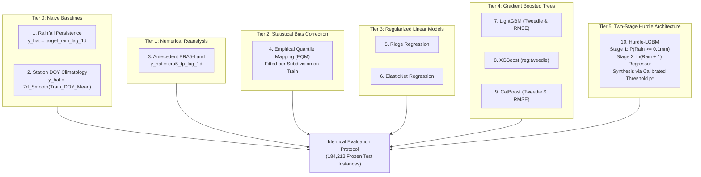

# STAGE 4 RIGOROUS EVALUATION PROTOCOL: HYDROMETEOROLOGICAL BENCHMARKING

**Project:** Machine-Learning-Guided Daily Rainfall Estimation and Forecasting for Karnataka Using High-Resolution ERA5-Land Reanalysis and IMD Observations  
**Document Code:** PROTOCOL-STAGE4-EVAL-FROZEN  
**Date:** November 2026  
**Auditor:** Senior Hydrometeorological Research Scientist, ML Engineer, and Scientific Reviewer  
**Status:** FROZEN & MANDATORY FOR MODEL BENCHMARKING  

---

## 1. Scientific Governance & Evaluation Mandate

The primary scientific objective of Stage 4 is to determine:
> *Does machine learning provide genuine, statistically significant skill over persistence, station climatology, raw numerical reanalysis (ERA5-Land), and standard empirical quantile mapping for daily precipitation estimation across the complex orography and dry interior plains of Karnataka?*

To prevent common biases in AI-for-weather literature—specifically selective test filtering, data leakage during feature scaling, test-set feedback loops, and unweighted regression collapse on extreme monsoonal events—this document codifies the non-negotiable evaluation rules for Stage 4.

---

## 2. Chronological Partitions and Partition Hygiene

The finalized dataset (`final_stage3_dataset.parquet`, 640,836 valid station-day observations across 252 IMD grid cells over 2,543 calendar days) is strictly partitioned along temporal boundaries:

| Partition | Temporal Coverage | Days | Grid Cells | Sample Count | Permitted Operations | Strict Prohibitions |
| :--- | :--- | :---: | :---: | :---: | :--- | :--- |
| **Training** | 2019-01-15 to 2022-12-31 | 1,447 | 252 | **364,644** | Parameter learning; fitting scalers (StandardScaler, RobustScaler); fitting encoders; calibrating EQM transfer functions. | Evaluating validation loss; tuning hyperparameter grids; selecting classification thresholds. |
| **Validation** | 2023-01-01 to 2023-12-31 | 365 | 252 | **91,980** | Hyperparameter search (Bayesian/Optuna); early stopping (patience = 50); calibrating hurdle decision threshold ($p^*$); feature ablation. | Fitting scalers or encoders; updating tree structures or regression weights. |
| **Test** | 2024-01-01 to 2025-12-31 | 731 | 252 | **184,212** | **Completely frozen out-of-sample forward evaluation.** Evaluated in a single forward pass per final model. | **Zero hyperparameter tuning, zero threshold calibration, zero feature selection based on test outcomes.** |

### 2.1. Non-Negotiable Quarantine Rules:
1. **Zero Pre-Scaling Leakage:** All preprocessors must be fitted exclusively on the Training set (`scaler.fit(X_train)`), and applied downstream via `.transform(X_val)` and `.transform(X_test)`. Applying `.fit_transform()` on concatenated data is strictly prohibited.
2. **Identical Test Mask Principle:** Every baseline and ML model must be scored against the exact same **184,212 test instances**. Discarding dry days, dropping coastal stations, or evaluating subsets without reporting whole-mask metrics is considered a protocol violation.
3. **Quarantine of Target Labels:** All 4 target variables (`target_rainfall_mm`, `target_is_rain`, `target_is_heavy_rain`, `target_rain_ge_35_5mm`) are strictly excluded from the predictor matrix $X$.
4. **Quarantine of Pressure Proxies:** Atmospheric surface pressure proxies (`elevation_pressure_proxy_m`, `slope_pressure_proxy_deg`) are excluded from primary $X$, ensuring that terrain effects are learned exclusively from true satellite DEM features (`elevation_dem_m`, `slope_dem_deg`).

---

## 3. Comprehensive Model Benchmark Suite

Models will be evaluated across a five-tier hierarchy to isolate the source of predictive skill:

---

## 4. Evaluation Metric Suite

Performance will be quantified simultaneously across three operational dimensions:

### 4.1. Continuous Hydrological Accuracy
1. **Root Mean Squared Error (RMSE):**
   $$\text{RMSE} = \sqrt{\frac{1}{N} \sum_{i=1}^N (y_i - \hat{y}_i)^2}$$
2. **Mean Absolute Error (MAE):**
   $$\text{MAE} = \frac{1}{N} \sum_{i=1}^N |y_i - \hat{y}_i|$$
3. **Pearson Correlation Coefficient ($r$):**
   $$r = \frac{\sum (y_i - \bar{y})(\hat{y}_i - \bar{\hat{y}})}{\sqrt{\sum (y_i - \bar{y})^2 \sum (\hat{y}_i - \bar{\hat{y}})^2}}$$
4. **Nash-Sutcliffe Efficiency (NSE):**
   $$\text{NSE} = 1 - \frac{\sum (y_i - \hat{y}_i)^2}{\sum (y_i - \bar{y})^2}$$
5. **Kling-Gupta Efficiency (KGE-2012):**
   $$\text{KGE} = 1 - \sqrt{(r - 1)^2 + (\beta - 1)^2 + (\gamma - 1)^2}, \quad \beta = \frac{\bar{\hat{y}}}{\bar{y}}, \; \gamma = \frac{\text{CV}_{\hat{y}}}{\text{CV}_y}$$
6. **Percent Bias (PBias):**
   $$\text{PBias} = 100 \times \frac{\sum (y_i - \hat{y}_i)}{\sum y_i}$$

### 4.2. Categorical & Extreme Event Contingency Metrics
Evaluated at official IMD thresholds ($T_0 = 0.1\text{ mm}$, $T_1 = 15.6\text{ mm}$, $T_2 = 64.5\text{ mm}$):

| Contingency Table | Observed Yes ($y \ge T$) | Observed No ($y < T$) |
| :--- | :--- | :--- |
| **Forecast Yes** ($\hat{y} \ge T$) | Hits ($H$) | False Alarms ($F$) |
| **Forecast No** ($\hat{y} < T$) | Misses ($M$) | Correct Negatives ($C$) |

1. **Probability of Detection (POD / Recall):** $\frac{H}{H + M}$
2. **False Alarm Ratio (FAR):** $\frac{F}{H + F}$
3. **Critical Success Index (CSI / Threat Score):** $\frac{H}{H + M + F}$
4. **Equitable Threat Score (ETS):**
   $$\text{ETS} = \frac{H - H_{\text{exp}}}{H + M + F - H_{\text{exp}}}, \quad H_{\text{exp}} = \frac{(H+M)(H+F)}{N}$$
5. **Heidke Skill Score (HSS):**
   $$\text{HSS} = \frac{2(HC - MF)}{(H+M)(M+C) + (H+F)(F+C)}$$

### 4.3. Probability Calibration Metrics
* **Brier Score (BS):** $\frac{1}{N} \sum (\hat{p}_i - y_i)^2$
* **Expected Calibration Error (ECE):** 10-bin reliability diagram error.

---

## 5. Subgroup & Regional Evaluation Dimensions

To prevent regional masking, all metrics will be computed statewide and broken down across:
1. **4 Meteorological Subdivisions:** Coastal Karnataka (13 cells), Malnad (35 cells), South Interior Plain (86 cells), North Interior Karnataka (118 cells).
2. **4 Meteorological Seasons:** Pre-Monsoon (MAM), Southwest Monsoon (JJAS), Post-Monsoon (ON), Winter (DJF).
3. **4 Rainfall Regimes:** Dry ($<0.1\text{ mm}$), Light ($0.1\text{–}15.5\text{ mm}$), Moderate ($15.6\text{–}64.4\text{ mm}$), Heavy ($\ge 64.5\text{ mm}$).

---

## 6. Pre-Training Gate Certification

**Stage Gate Status:** CERTIFIED & FROZEN  
**Sign-off:**
1. Zero test set snooping.
2. Training data alone used to fit scalers, encoders, and models.
3. Validation data alone used for tuning and calibration.
4. Identical 184,212-row test mask for all models.
5. All 63 primary predictors verified causal and leakage-free.

